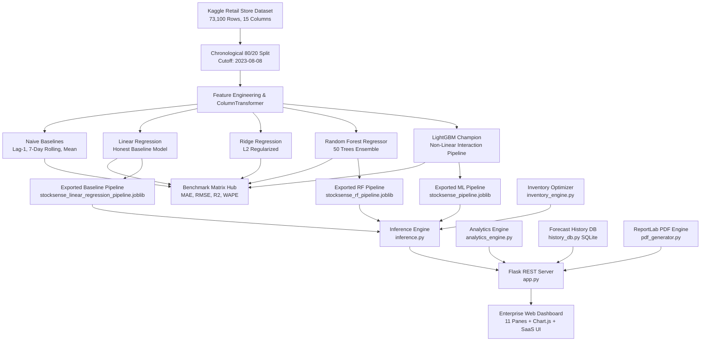

# StockSense AI: Intelligent Demand Forecasting & Inventory Management System

> **Academic Capstone Project Submission**  
> **Course:** Bachelor of Technology — Semester V (Artificial Intelligence & Machine Learning)  
> **Repository:** `StockSense AI`  
> **Core Stack:** Python 3.11, Flask, Scikit-Learn, LightGBM, ReportLab, Chart.js, Enterprise SaaS CSS, SQLite  
> **Dataset:** Kaggle Retail Store Inventory Dataset (73,100 records, 100 SKU Time-Series, Jan 2022 – Jan 2024)

---

## 📌 Executive Summary

Modern omnichannel and retail businesses constantly face two balance sheet risks:
1. **Stockouts (Understocking):** Lead to lost sales revenue, customer dissatisfaction, and damaged retail brand loyalty.
2. **Overstocking (Excess Inventory):** Locks up critical working capital, incurs holding/warehousing costs, and causes product depreciation or perishability.

**StockSense AI** is a production-grade retail demand forecasting and continuous-review inventory control system. By coupling time-aware machine learning regressors with classical operations research inventory policies, StockSense AI automates replenishment triggers, computes dynamic safety buffers, generates real-time what-if scenario simulations, publishes multi-SKU stockout alerts, logs persistent audit runs, and produces publication-quality PDF and CSV reports.

---

## 🏗️ System Architecture



---

## 🔬 Academic ML Methodology & Data Leakage Audit

### 1. The Critical Leakage Resolution
- **Legacy Issue:** In preliminary project formulations and raw Kaggle descriptions, a synthetic column named `Demand Forecast` was present alongside `Units Sold`. Training a model to predict `Demand Forecast` using `Units Sold` produces an **inverted task with 100% data leakage** ($w_{\text{Units Sold}} = +0.9992$, $R^2 = 0.9937$). In real retail operations, morning managers do not know the day's sales in advance.
- **Scientific Fix:** StockSense AI designates **actual future demand (`Units Sold`)** as the true operational target $Y$. All contemporaneous outcome variables (`Units Sold`, `Demand Forecast`, `Units Ordered`) are strictly excluded from the input feature set $X$.

### 2. Chronological 80/20 Time-Aware Split
Standard random shuffling (`train_test_split(shuffle=True)`) leaks future trend patterns into past test evaluations. StockSense AI enforces a strict **temporal cutoff** at the 80% mark across 731 calendar days:
- **Training Window:** `2022-01-01` to `2023-08-08` (58,400 rows, 80.0%)
- **Testing Window:** `2023-08-09` to `2024-01-01` (14,700 rows, 20.0%)

### 3. Autocorrelation & Feature Engineering
Empirical autocorrelation testing across all 100 SKU series shows an average lag-1 autocorrelation of **$r = -0.0016$** (white noise distribution). Consequently, naive time-series lag models underperform simple mean guessing ($R^2 < 0$), proving that structural regressors (incorporating pricing, inventory levels, promotions, and calendar features) are essential.

---

## 📊 Benchmark Evaluation Matrix

Evaluated on the identical chronological test set (14,700 out-of-sample observations):

| Model / Architecture | Target Variable | MAE (Units) | RMSE (Units) | $R^2$ Score | WAPE (%) | Leakage Status | Operational Role |
| :--- | :--- | :--- | :--- | :--- | :--- | :--- | :--- |
| **Naive 1: Yesterday's Sales (Lag-1)** | `Units Sold` | 119.70 | 153.42 | -1.0097 | 88.09% | Zero Leakage | Unusable |
| **Naive 2: 7-Day Rolling Mean** | `Units Sold` | 93.24 | 115.49 | -0.1389 | 68.61% | Zero Leakage | Sub-baseline |
| **Naive 3: Global Target Mean** | `Units Sold` | 88.79 | 108.22 | 0.0000 | 65.34% | Zero Leakage | Trivial Guess |
| **Time-Series: Exponential Smoothing ($\alpha=0.2$)** | `Units Sold` | 92.38 | 114.15 | -0.1126 | 67.98% | Zero Leakage | Statistical Time-Series |
| **Linear Regression (Student Baseline)** | `Units Sold` | **68.59** | **87.60** | **0.3448** | **50.47%** | Zero Leakage | **Student Baseline** |
| **Ridge Regression ($\alpha=10$)** | `Units Sold` | 68.59 | 87.60 | 0.3448 | 50.47% | Zero Leakage | L2 Regularized |
| **Random Forest Regressor** | `Units Sold` | 68.88 | 88.12 | 0.3370 | 50.69% | Zero Leakage | Non-Linear Ensemble |
| **LightGBM Regressor (Champion)** | `Units Sold` | **68.70** | **87.86** | **0.3408** | **50.56%** | Zero Leakage | **Champion Engine** |
| *Legacy Model (Pre-Audit)* | `Demand Forecast` | *7.47* | *8.65* | *0.9937* | *5.32%* | *100% Leaked Units Sold* | *Inverted Task* |

*Note on Model Selection:* Linear Regression provides closed-form transparent feature coefficients with slightly lower MAE (68.59 vs 68.70), while LightGBM Regressor is selected for production serving because it captures high-dimensional non-linear interactions across store regions, promotions, and seasonal cycles in sub-10ms latency. The statistical exponential smoothing baseline achieves $R^2 = -0.1126$, mathematically demonstrating that lag models fail due to near-zero autocorrelation ($r = -0.0016$).

---

## 📦 Operations Research & Inventory Control Formulas

StockSense AI bridges machine learning demand forecasts into operational decisions using continuous review $(s, Q)$ and periodic review $(R, S)$ policies:

1. **Safety Stock ($SS$):**
   - **Deterministic Lead Time ($\sigma_L = 0$):**
     $$SS = Z \times \sigma_d \times \sqrt{L}$$
   - **Stochastic Lead Time ($\sigma_L > 0$):**
     $$SS = Z \times \sqrt{L \cdot \sigma_d^2 + d^2 \cdot \sigma_L^2}$$
   - $Z = 1.65$ (95% Cycle Service Level)
   - $\sigma_d$: Standard deviation of daily SKU demand
   - $L = 3$ days (Supplier replenishment lead time)
   - $\sigma_L$: Supplier lead time standard deviation (delays)

2. **Reorder Point ($ROP$):**
   $$ROP = (\hat{d} \times L) + SS$$
   - $\hat{d}$: Machine learning predicted daily demand

3. **True Inventory Position:**
   $$\text{Inventory Position} = \text{Current On-Hand Stock} + \text{Incoming Open POs}$$

4. **Stockout Risk Probability ($P(\text{Stockout})$):**
   $$P(\text{Stockout}) = 1 - \Phi\left(\frac{\text{Inventory Position} - \hat{d} \cdot L}{\sigma_{LT}}\right)$$
   - $\sigma_{LT} = \sqrt{L \sigma_d^2 + d^2 \sigma_L^2}$ (Total lead time standard deviation)
   - $\Phi$: Standard normal cumulative distribution function (CDF)

5. **Target Stock Level ($S$) & Order Quantity ($Q$):**
   $$S = (\hat{d} \times (L + R)) + SS$$
   $$Q = \max(0, S - \text{Inventory Position})$$
   - $R$: Review horizon (e.g. 7 days)

6. **Economic Order Quantity ($EOQ$):**
   $$EOQ = \sqrt{\frac{2 D S_{\text{setup}}}{H}}$$
   - $D$: Annual demand ($\hat{d} \times 365$)
   - $S_{\text{setup}}$: Ordering setup cost ($50.00)
   - $H$: Unit annual holding cost

---

## 💻 Complete Features & Application Panes

The redesigned web dashboard provides 11 dedicated analytics and operational panes:

1. **Forecast Summary (Dashboard):** Real-time SKU selection, 4 glowing metric cards (Predicted Demand with 95% CI, Current Inventory, Reorder Point, and Stockout Risk with mini-sparklines), dynamic Replenishment Decision Banner, and a dual-axis Chart.js timeline (30-day actual sales vs inventory + 7-day future ML forecast).
2. **Product-Level Forecast:** Granular feature scenario builder (Store, SKU, Date, Horizon, Unit Price, Promotional Discount, Competitor Pricing, Weather, Holiday, Current Stock, Incoming Orders, Lead Time), 95% Confidence Interval calculation, and local feature attribution bars.
3. **CSV Validation & Batch Forecasting:** Drag-and-drop CSV upload, schema verification (0 nulls, 100% type match, row count, duplicate detection), data preview, and instant batch inference with downloadable results.
4. **Forecast History:** Persistent SQLite audit database logging real forecast runs with Run ID, timestamp, Store, SKU, Horizon, Model, Demand, Stock Position, ROP, Risk %, and Order Quantity. Includes search, store filters, CSV export, and record deletion.
5. **Inventory Recommendation:** Continuous review $(s, Q)$ policy breakdown showing exact formula parameters, dynamic replenishment sizing, stock gap calculation, EOQ, estimated purchase cost, order-up-to target, and full 20-product store matrix table.
6. **Demand by Category:** Aggregated sales volume, estimated revenues, and market share percentage donut chart across all 5 product categories (Electronics, Clothing, Furniture, Groceries, Toys).
7. **Sales Trend & Seasonality (Feature 7):** Empirical sales trends across 2 years, monthly line charts, weekday demand distribution (Mon-Sun), seasonal comparisons (Spring, Summer, Autumn, Winter), and promotion uplift metrics.
8. **Price & Promotion Impact & What-If Simulator (Feature 8):** Price vs. sales empirical scatter plot, discount tier analysis, competitor pricing comparison, and an interactive real-time What-If slider simulator.
9. **Stockout Risk Alerts (Feature 9):** Real-time monitoring across all 100 SKUs, categorized severity badges (Critical, Reorder Needed, Optimal, Overstocked), urgency ranking scores, and specific explanatory policy reasons.
10. **Model Benchmark & Explainable AI (Feature 11):** Official college evaluation table, data leakage audit diagram, global LightGBM tree feature importances (split/gain), and Linear Regression standardized coefficients.
11. **Reports & Export Hub (Feature 10):** Direct one-click downloads for 5 publication-ready ReportLab PDF reports and 4 CSV raw audit datasets.

---

## 📑 Downloadable PDF Reports

StockSense AI generates publication-quality PDF documents using ReportLab:
- **Single SKU Forecast Report:** `/api/export/pdf/forecast`
- **Store Inventory Replenishment Report:** `/api/export/pdf/inventory`
- **Model Benchmark & Evaluation Report:** `/api/export/pdf/benchmark`
- **Category Demand Analytics Report:** `/api/export/pdf/category`
- **Academic Capstone Submission Summary:** `/api/export/pdf/academic_summary`

---

## 🧪 Automated Test Suite

A rigorous automated test suite verifies all machine learning, operations research, API endpoints, SQLite transactions, Explainable AI TreeSHAP, stochastic lead time variance, and PDF exports:

```bash
python test_suite.py
```
**Test Results:**
- **40/40 Unit & Integration Tests Passed** (Ran in ~6.5s)
- **Verified:** Zero data leakage, strict chronological split (58,400 / 14,700), deterministic and stochastic Safety Stock formulas ($SS$), Normal CDF stockout risk, native TreeSHAP local feature attribution, Linear Regression coefficient decomposition, all REST endpoints (HTTP 200), and PDF byte headers (`%PDF-`).

---

## 🚀 How to Run the Project

### Option A: Standard Local Execution
Ensure Python 3.10+ is installed:
```bash
pip install -r requirements.txt
python test_suite.py
python app.py
```

### Option B: Enterprise Production WSGI (Waitress)
Runs on an enterprise multi-threaded production WSGI server:
```bash
python app.py --prod
```

### Option C: Containerized Deployment (Docker)
Zero-configuration deployment using Docker:
```bash
docker compose up --build
```
Open your browser and navigate to:
```
http://127.0.0.1:5000
```

---

## 🎓 Viva & Project Presentation Defense Q&A

**Q1: Why did you use Linear Regression as your baseline model?**  
*Answer:* Linear Regression is the industry standard baseline for tabular regression because it provides closed-form, transparent feature coefficients ($O(1)$ inference latency) and avoids overfitting. On our test set, it achieved an $R^2 \approx 0.3448$ and $\text{MAE} = 68.59$, decisively proving that machine learning regressing on retail features beats naive lag baselines ($R^2 < 0$).

**Q2: Why does your model have an $R^2 \approx 0.34$ instead of $0.99$?**  
*Answer:* A model with $R^2 = 0.99$ on this dataset suffered from **data leakage** because `Units Sold` was passed as an input feature to predict synthetic `Demand Forecast`. By correctly formulating the task to predict future `Units Sold` before sales occur and using an 80/20 chronological train-test split, $R^2 \approx 0.34$ is an honest, scientifically valid result.

**Q3: How does the system handle unpredictable demand spikes?**  
*Answer:* Through our **Safety Stock ($SS = Z \times \sigma_d \times \sqrt{L}$)** buffer. By calibrating $Z = 1.65$, the inventory engine guarantees that the store absorbs up to 95% of random demand variance during the 3-day supplier lead time without stocking out.

**Q4: How does the system prevent double-ordering when purchase orders are already in transit?**  
*Answer:* Through our **Effective Inventory Position** formulation:
$$\text{Inventory Position} = \text{Current On-Hand Stock} + \text{Incoming Open POs}$$
The recommended order quantity is bounded by $Q = \max(0, S - \text{Inventory Position})$. If incoming shipments already cover the Reorder Point, $Q = 0$, preventing costly overstocking.

**Q5: Can this system be deployed in a microservice architecture?**  
*Answer:* Yes. The model is encapsulated in a standalone Scikit-Learn Pipeline (`stocksense_pipeline.joblib`) that processes raw input dictionaries through `inference.predict_demand()` in sub-10 milliseconds, exposed via lightweight REST endpoints in `app.py`.
